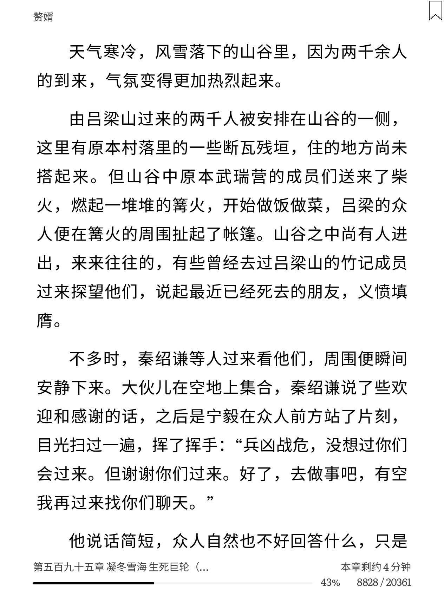
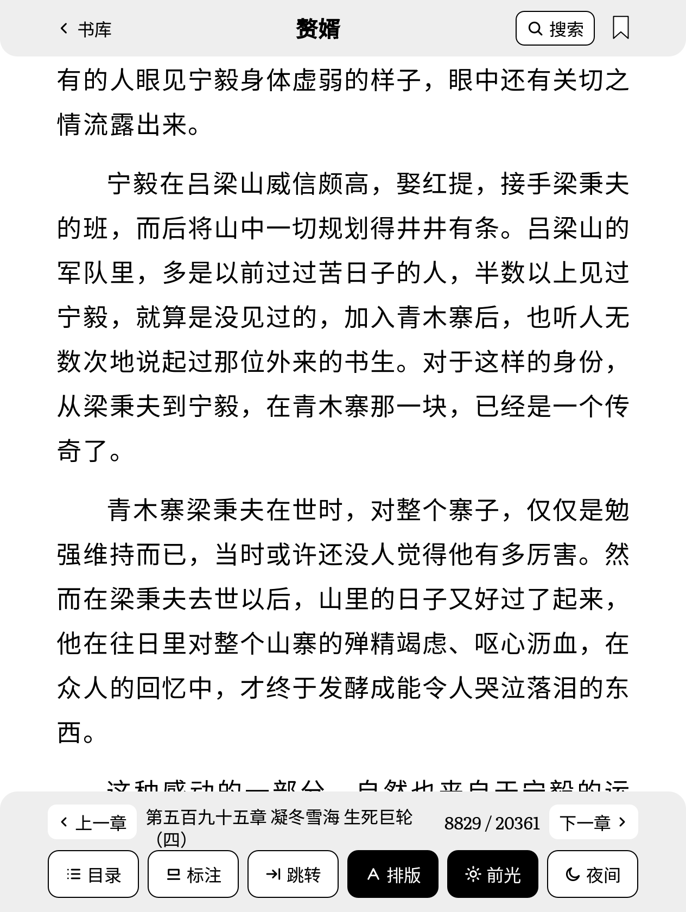
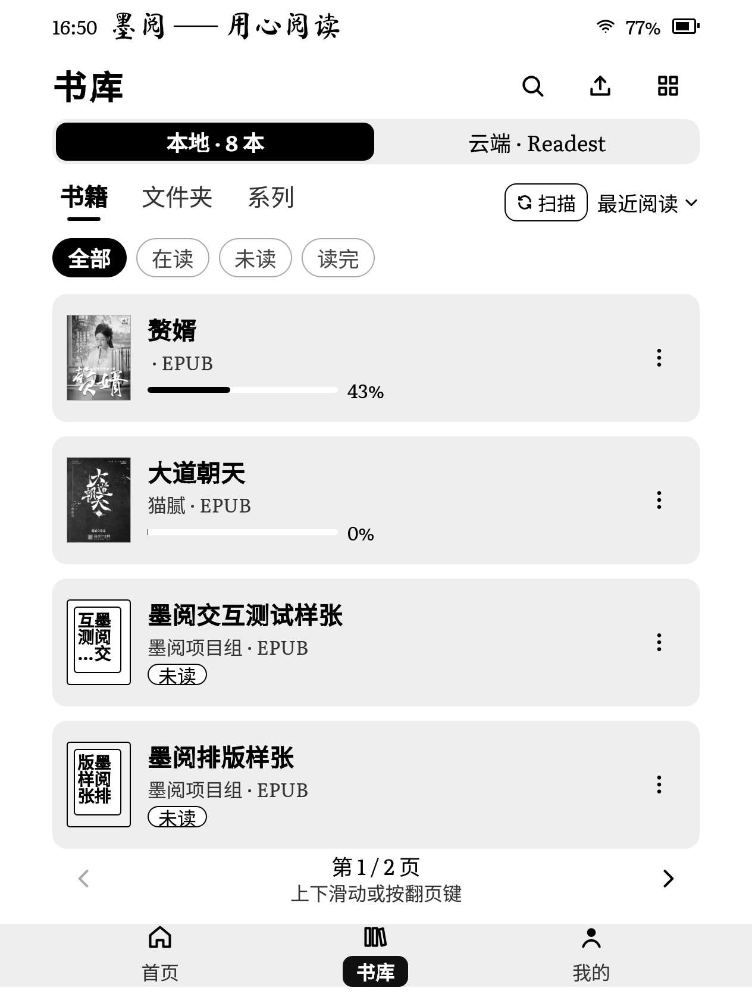
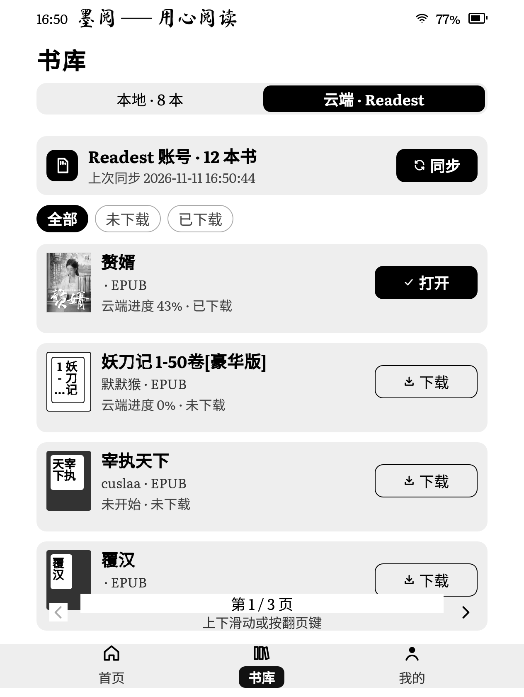
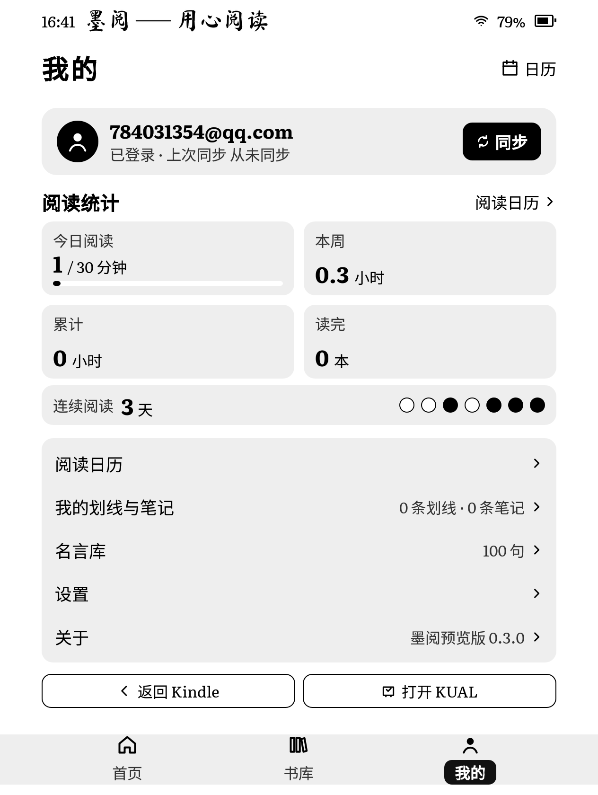
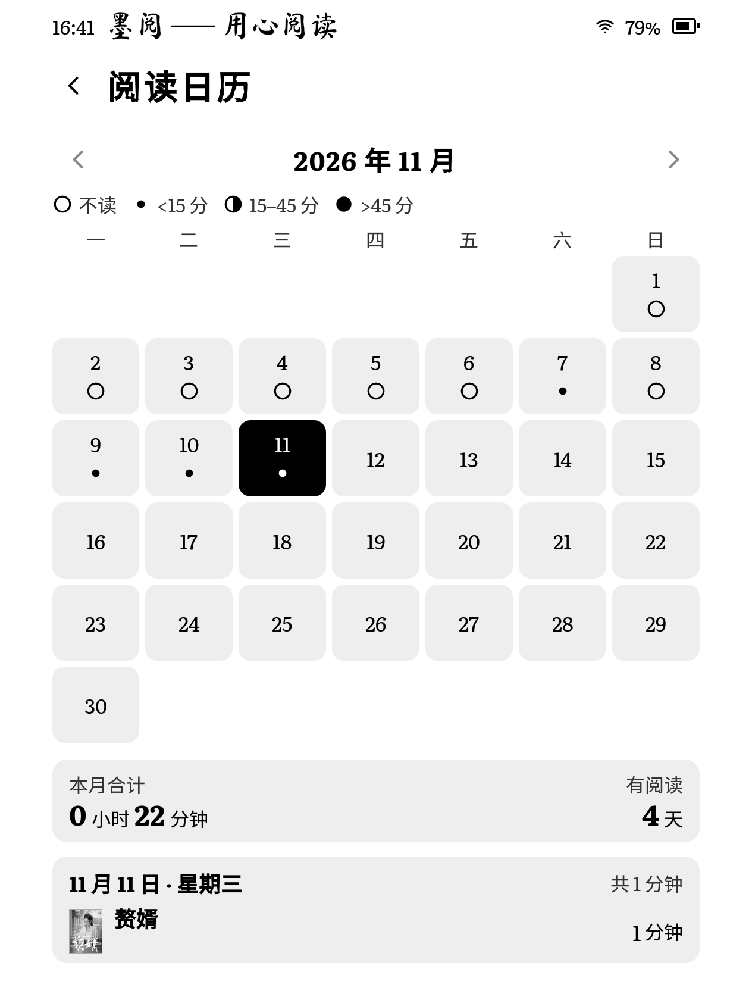

<div align="center">


# 墨阅 Kindle · Moyue Kindle

**把吃灰的越狱 Kindle 变成你的个人书城。**
一个直接跑在 Kindle 硬件上的原生阅读器：Rust + Aristotle 底座 + KOReader 排版引擎，兼容 Readest 账号同步。

[](LICENSE)
[-black.svg)](#支持范围)
[](#项目状态)
[](Cargo.toml)

[项目主页](https://jasonchencnn.github.io/moyue-kindle/) · [安装说明](docs/INSTALL.md) · [从源码构建](docs/BUILD.md) · [已知问题](docs/KNOWN-ISSUES.md)

</div>

> **本项目不是亚马逊官方产品，与 Amazon 无关。** 仅支持已越狱的设备和无 DRM 书籍，不包含任何越狱、破解或去除 DRM 的代码。越狱与安装第三方软件的风险由使用者自行承担。

## 这是什么

墨阅（Moyue）是一个开源的全端阅读器项目：一个书库，手机、电脑、平板、安卓墨水屏和越狱 Kindle 上的进度、笔记、书架实时同步。目标用户是墨水屏玩家和 Kindle 用户——Kindle 退出中国市场后，大量设备在抽屉里吃灰，而它们还有一块很好的屏幕和电池。

**本仓库是墨阅的 Kindle 原生客户端**，也是整个项目的主线和核心亮点：

- **原生**：Rust 编写，直接跑在 Kindle Linux 上，不经过浏览器、WebView 或安卓；静态链接单个可执行文件。
- **排版**：EPUB/TXT 使用 [KOReader](https://github.com/koreader/koreader) 同源的 [koreader/crengine](https://github.com/koreader/crengine) 引擎，支持中文排版与**局部重排**（改字号时先排当前页，后台补全书）。
- **底座**：[Aristotle](https://github.com/piotrkowski/aristotle)（Kindle 客户端框架）经 `git subtree` 引入，复用其 HAL、启动接管、书库与阅读器框架。
- **同步**：兼容 [Readest](https://github.com/readest/readest) 的 `/api/sync` 协议，用同一个 Readest 账号同步阅读进度、高亮与笔记，并能下载云端书库；进度以 XPointer 保存，与 KOReader 互通。
- **界面**：中文优先的双语界面（简中 / English / polski），首页、书库、阅读页、统计、日历、名言库、休眠屏都按墨水屏重新设计。

## 截图

全部为 **Kindle Oasis 2 真机截图**（1264×1680，300 ppi），不是设计稿渲染。

| 首页 | 阅读页 | 阅读菜单 |
| --- | --- | --- |
|  |  |  |
| **书库 · 列表** | **书库 · 网格** | **云端书库** |
|  |  |  |
| **我的** | **阅读日历** | **休眠页** |
|  |  |  |

## 功能

| 类别 | 内容 |
| --- | --- |
| 阅读 | EPUB、TXT（UTF-8 / GBK / GB18030）、PDF、CBZ，按文件情况支持无 DRM 的 MOBI/AZW3；目录、跳转、链接与脚注、选词、高亮、夜间模式 |
| 排版 | 字号、行距、页边距、首行缩进、段间距；内置思源黑体（中文回退）与 Literata（西文），可放入 `fonts/` 使用自定义字体；局部重排 |
| 书库 | 全盘扫描用户存储、手动选择扫描目录、扫描结果逐本勾选后导入、本地/云端分段、网格/列表、拼音排序、搜索、长按菜单、滑动翻页 |
| 首页与统计 | 时钟与农历、继续阅读、最近阅读、每日一句、桌宠；阅读统计、阅读日历、单书统计、名言库 |
| 同步 | Readest 账号登录（邮箱密码 / 官方认证中转）、进度与高亮笔记拉取和推送、自动推送开关、云端书库下载 |
| 系统 | KUAL 启动、原系统界面接管与恢复、实体翻页键、重力感应旋转、前光跟随原系统、休眠/唤醒、四种休眠屏与自选图片 |
| 传书 | Wi-Fi 传书（局域网网页上传书籍、字体、休眠图）、USB 放书 |

## 支持范围

| 项 | 要求 |
| --- | --- |
| 机型 | Kindle Oasis 2（第 9 代，2017，设备代号 `cognac` / `zelda`） |
| 固件 | 5.16.x（开发机为 5.16.2.1.1） |
| 前置条件 | 已越狱，KUAL 已安装并可正常启动 |
| 启动方式 | KUAL → 墨阅 → 启动墨阅（自启动可选，默认关闭） |
| 书籍 | 无 DRM 的 EPUB / TXT / PDF / CBZ / MOBI / AZW3 |

Paperwhite 4 的代码仍在仓库里，但**未验证、不提供安装支持**；其他机型与固件暂不支持。启动守卫会拒绝不匹配的机型，避免把别人的设备弄坏。

## 安装

安装包需要在本机或 CI 构建（见 [docs/BUILD.md](docs/BUILD.md)），解压到 Kindle 的 USB 盘根目录，然后从 KUAL 启动。完整的准备、校验、安装、更新、卸载与恢复步骤见 **[docs/INSTALL.md](docs/INSTALL.md)**。

> 预览版没有验证过整机救砖路径。安装前务必备份 `.aristotle/`（进度、偏好、索引）、`documents/` 和 `My Clippings.txt`。

## 项目状态

当前是 **预览版 / 实验性（preview）**，不是稳定版。已经在 Kindle Oasis 2 上验证过的部分：排版引擎、翻页、选词高亮、目录与链接、休眠唤醒、前光、Wi-Fi 传书、中文界面、局部重排。仍在真机验收中的部分：最新一轮扫描导入流程、手动同步与自动推送、长时阅读内存表现、真实账号跨端同步。

源码状态领先于最后一次发布的 0.3.0 预览包，仓库里的代码按最新工作区整理。稳定性、已知问题与限制见 [docs/KNOWN-ISSUES.md](docs/KNOWN-ISSUES.md)，变更历史见 [docs/RELEASE-NOTES.md](docs/RELEASE-NOTES.md)。

## 同步兼容性

墨阅不是 Readest 的 fork，而是**实现 Readest 同步协议的独立客户端**：

- 用 Readest 账号（`readest.com`）登录，使用官方认证中转 `auth-cf.readest.com`，账号与密码不写入日志；
- `/api/sync` 拉取和推送阅读进度（XPointer）、高亮与笔记，合并规则为字段级 LWW + 笔记墓碑；
- 云端书库列表与下载；
- XPointer 与 KOReader 同源，可与 KOReader 的进度互认；
- 限制：TXT 进度目前只存本地；同一本书跨端 `book_hash` 不同时按百分比同步；超长文本节点与 `<pre>` 首行定位有已知偏差。

协议细节与限制见 [docs/SYNC.md](docs/SYNC.md)。

## 从源码构建

```sh
git clone --recursive https://github.com/jasonchencnn/moyue-kindle.git
cd moyue-kindle
./scripts/check.sh        # 纯 Rust 部分：fmt + clippy + 测试，不需要 C++ 工具链
```

设备包需要 Zig 交叉工具链、Plato 的 C 库和 crengine 源码，完整的依赖、缓存位置与构建顺序见 [docs/BUILD.md](docs/BUILD.md)。

## 代码结构

| 目录 | 内容 |
| --- | --- |
| `core/` | 平台无关逻辑：书籍哈希（partialMD5）、数据模型、合并规则、书库索引、进度与统计、Readest 同步客户端 |
| `engine/` | crengine 排版引擎的 FFI 层、补丁、黄金图测试 |
| `platform/` | 基础类型（灰度帧缓冲等） |
| `aristotle/` | Kindle 客户端本体：HAL、启动接管、UI、书库、网络、字体与 i18n（Aristotle 子树） |
| `kual/` | KUAL 扩展与设备探测 |
| `scripts/` | 本地与 CI 检查、截图、QA |
| `licenses/` | 随发布包附带的第三方许可证文本 |

更完整的分层、数据流与关键决策见 [docs/ARCHITECTURE.md](docs/ARCHITECTURE.md) 与 [docs/DECISIONS.md](docs/DECISIONS.md)。

## 致谢

本项目站在这些开源项目之上：

- [Aristotle](https://github.com/piotrkowski/aristotle) —— Kindle 客户端底座（AGPL-3.0）
- [Plato](https://github.com/baskerville/plato) 与 MuPDF —— PDF/CBZ 渲染、字体与排版基础设施（AGPL-3.0）
- [KOReader](https://github.com/koreader/koreader) 与 [koreader/crengine](https://github.com/koreader/crengine) —— EPUB/TXT 排版引擎、XPointer、Kindle 经验（GPL-2.0+ / AGPL-3.0）
- [Readest](https://github.com/readest/readest) —— 同步协议与账号体系（AGPL-3.0）
- [FBInk](https://github.com/NiLuJe/FBInk)、[Noto Sans SC](https://github.com/notofonts/noto-cjk)、[Literata](https://github.com/googlefonts/literata)、[OpenCC](https://github.com/BYVoid/OpenCC)、[rime-pinyin-simp](https://github.com/rime/rime-pinyin-simp) 等

完整的第三方清单与许可证见 [THIRD_PARTY.md](THIRD_PARTY.md) 和 [`licenses/`](licenses/)。

## 参与贡献

欢迎提交 issue 和 PR。请先阅读 [CONTRIBUTING.md](CONTRIBUTING.md)；涉及大改动请先开 issue 讨论。**不接受**任何盗版书源、DRM 绕过或破解亚马逊固件的贡献。

## 许可证

[AGPL-3.0-or-later](LICENSE)。分发二进制时请同时提供对应源码（见 [docs/RELEASE-NOTES.md](docs/RELEASE-NOTES.md) 的源码包说明）。

---

## English

**Moyue Kindle** is a native e-reader client for jailbroken Kindles, written in Rust and built on [Aristotle](https://github.com/piotrkowski/aristotle) with [KOReader's crengine](https://github.com/koreader/crengine) as the EPUB/TXT layout engine. It runs directly on the device — no Android, no WebView — and syncs reading progress, highlights and notes with a [Readest](https://github.com/readest/readest) account.

- **Platform**: Kindle Oasis 2 (9th gen, 2017), firmware 5.16.x, jailbroken with KUAL.
- **Status**: preview / experimental. Not affiliated with Amazon. DRM-free books only.
- **License**: AGPL-3.0-or-later.
- **Docs**: [Install](docs/INSTALL.md) (Chinese) · [Build](docs/BUILD.md) · [Architecture](docs/ARCHITECTURE.md) · [Known issues](docs/KNOWN-ISSUES.md) · [Sync](docs/SYNC.md)

The project is part of **墨阅 (Moyue)**, an open-source cross-platform reader whose goal is one library with progress, notes and books shared across phone, desktop and e-ink devices.
